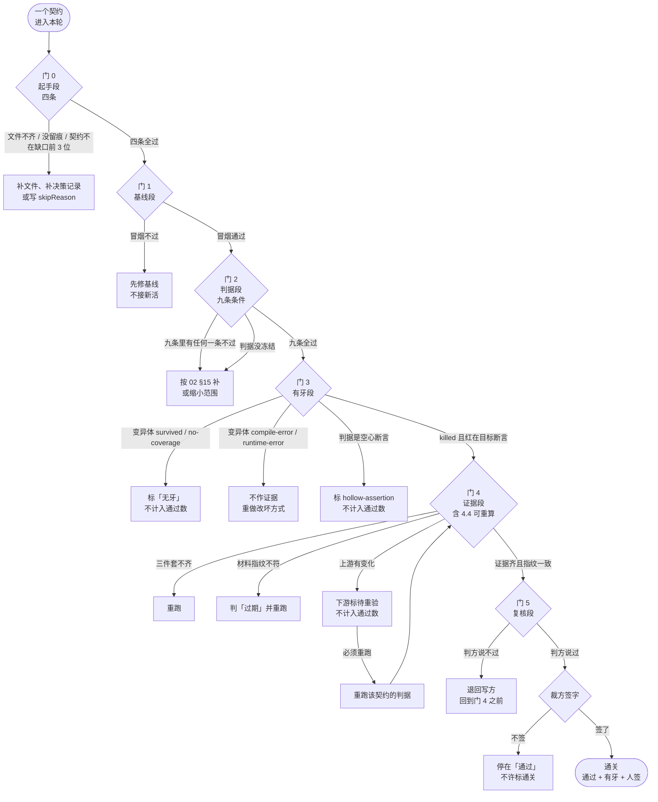
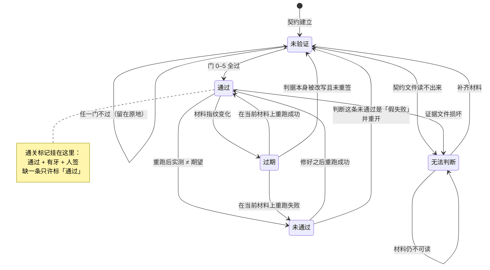
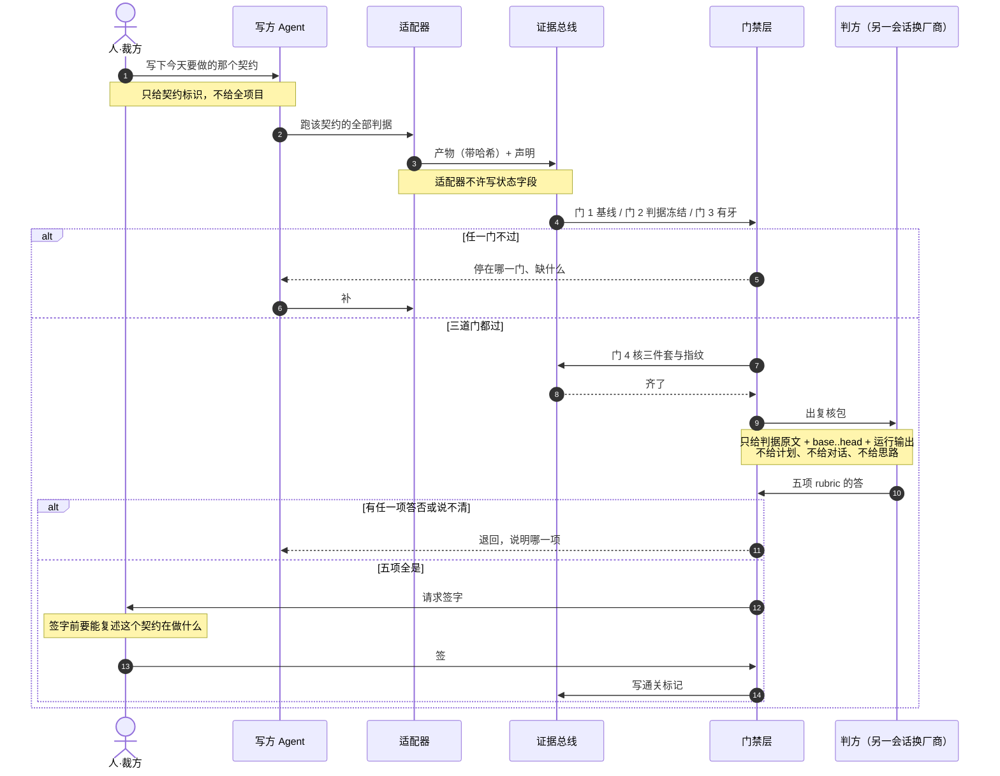
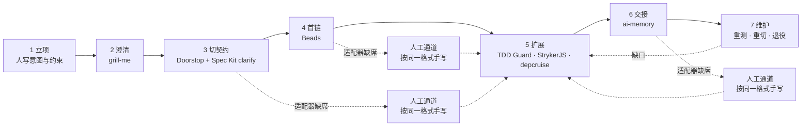
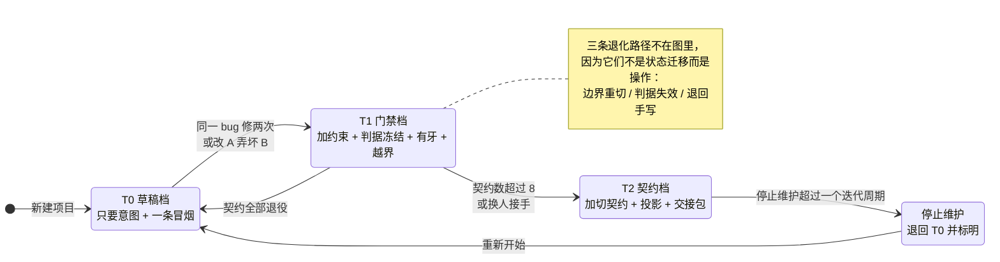
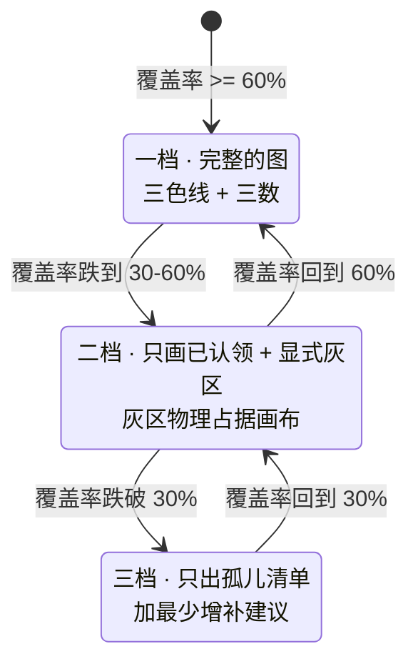
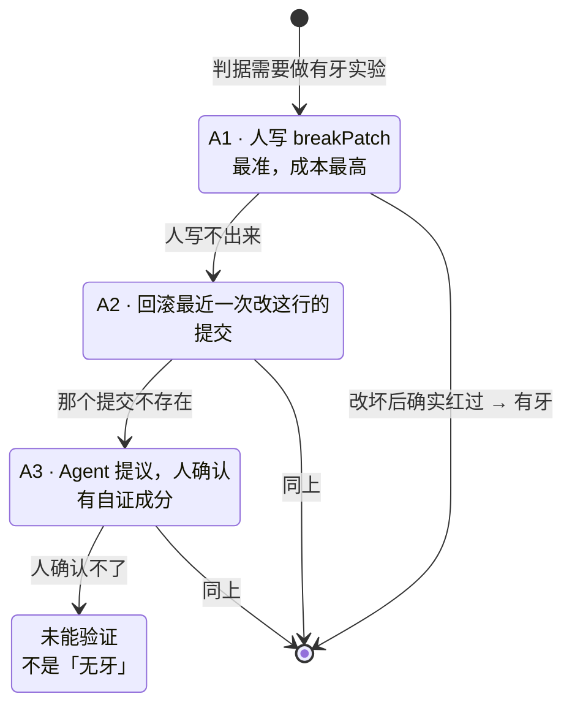
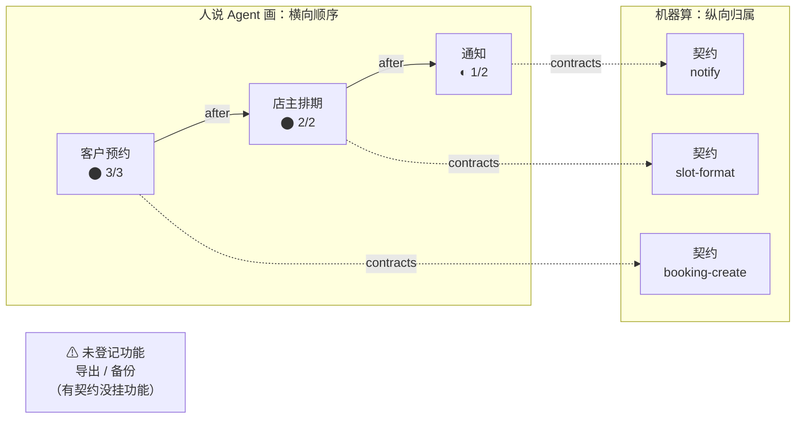

# 八张图

每张图前面一句读法，后面一段「它替代了哪段文字」。图用 Mermaid，GitHub 直接渲染。

---

## 图一 · 门禁链

**读法**：一个工作单元从「未验证」走到「通过」，必须依次穿过六道门。任何一道没过，状态停在上一个词。Agent 无权跳过，也无权自己宣布穿过。



**它替代了**：原来那段「五道门表格 + 每门失败怎么办」的两页文字。

**门 0 是后加的。** 它判的不是「这一轮做得对不对」，是「有没有资格开始这一轮」：意图与约束是否已落盘、改了意图有没有留痕、挑的契约是不是缺口里最该做的、交接包是不是齐。四条全部能从文件与哈希判出，见 [02-规格.md](02-规格.md) 第十五节第 0 小节。

**门 3 在图里画了四种出口**，因为变异体状态不同，证据价值不同：`survived`/`no-coverage` 是无牙，`compile-error`/`runtime-error` 不作任何证据，`hollow-assertion` 是判据本身空心，只有 `killed` 且红在目标断言才算有牙。**把这四种压成一个「无牙」，正是上一版被外部审计打穿的地方。**

**「待重验」必须经过重跑，不能直接去签字。** 上一版图里有一条 `PENDING → G5`（判方）的边，等于**上游变了的契约可以跳过重验，直接让判方看、然后人签**——那与 §11「待重验不计入通过数」直接冲突。复审的核验脚本走了一遍图，报出 `containsRecheckStep: false`，就是指这条。现在改成 `PENDING → RECHECK → G4`：重跑，重跑通过才清掉标记，才能继续往门 5 走。

**门 4 的「待重验」出口说明**：上游变了就标 `pending-recheck`、不计入通过数。**上一版这里是「剪断」（比 `conclusionHash`，不变就不失效）——那条规则被复审用四层依赖反例推翻了，已撤回。** 现在只有能证明「下游消费的输入或产物一致」才允许恢复，见 [02-规格.md](02-规格.md) 第十一节。

**门 2 在图里是一个节点，标签写明「九条条件」。** 九条的正文在 [02-规格.md](02-规格.md) 第十五节。图上不展开九条，因为展开会看不清主干；但标签必须写出条数，否则图会让人以为门 2 只查一件事——那正是 17- 里 I2「图不可信」的形态。

**一个必须记住的细节**：`通关` 不是第六个状态词，它是挂在「通过」上的一个标记。这张图里 `DONE` 那个节点是标记，不是状态。

---

## 图二 · 状态机

**读法**：五个状态之间的每一条边，都对应一个外部动作，不对应任何人的判断或模型的自我评价。



**它替代了**：原来那张「五个状态词 + 进入条件 + 页面表现」的三列表格。表格还在，但改成参考手册里的一节，不再当正文读。

**三条不许违反**：

1. 没有任何一条边由「模型说完成了」触发。
2. `未通过 → 未验证` 这条边只允许人来走，而且要走必须写一条决策记录说是假失败。
3. `无法判断` 不许直接跳到 `通过`，必须先回到 `未验证`。

---

## 图三 · 对象关系

**读法**：七种对象。两种是人的（意图、约束），四种是机器的（契约、判据、证据、**功能**），一种是两者共用的（决策记录）。

```mermaid
erDiagram
    INTENT ||--o{ CONTRACT : "说明为什么要有它"
    INTENT ||--o{ DECISION : "变更时留下痕迹"
    CONSTRAINT }o--o{ OBLIGATION : "落成禁令或检查"
    CONTRACT ||--|{ OBLIGATION : "含 1 到 n 条"
    CONTRACT ||--o{ EVIDENCE : "产生 0 到 n 次"
    OBLIGATION ||--o{ EVIDENCE : "被验 0 到 n 次"
    CONTRACT ||--o{ DECISION : "边界或判据变更时"
    CONTRACT }o--o{ CONTRACT : "dependsOn"
    CONTRACT }o--o{ FUNCTION : "被挂 0 到 n 次（挂 0 = 孤儿契约）"

    INTENT {
        string 四节 "为什么做·服务谁·什么算成功·不做什么"
        bool 只由人改
    }
    CONSTRAINT {
        string 一行一条 "不许 / 必须 + 具体动作"
        int 上限 12
    }
    CONTRACT {
        string id "与目录名一致，定下不改"
        string title "业务语言"
        string why "三行以内，超过说明该拆"
        list scope "拥有哪些代码"
        list dependsOn "只写标识"
        bool provisional "一律先为真"
        bool retired "含日期与理由"
    }
    OBLIGATION {
        string kind "command 或 human"
        string command "单条命令，不许串联"
        string expect "退出码 + 可选断言"
        string frozenHash "改判据必须重算"
        string signedBy "空着 = 未冻结"
        bool required "为真才进分母"
        string teeth "有牙实验的时间与结果"
    }
    EVIDENCE {
        string 三件套 "start / report / end"
        string 指纹 "材料哈希"
        int 退出码 "直读，不经包装"
    }
    DECISION {    FUNCTION {
        string id "稳定标识，如 booking-crossmidnight"
        string title "一句话，给人看"
        string successCriterion "INTENT 原文，不许改写"
        list contracts "至少一个；空数组 = 声明了没做"
        list after "流程图上后面是谁，Agent 从原话生成"
        string source "人的原话，逐字，空即红（INV-18）"
        string note "这个框为什么存在"
    }

    DECISION {
        string 五段 "问题·可选·选了哪个·为什么·何时翻案"
        bool 不可改写
    }
```

**它替代了**：原来六个 `###` 小节，每个字段一段散文。

**两处图里画不出来、必须看文字的关系**：

1. `CONTRACT` 对自己的 `dependsOn` 是一条自环边，Mermaid 画自环会很难看，所以写在表里。
2. `EVIDENCE` 的三份文件互相哈希，这是三份之间的三角关系，ERD 表达不了，写在 [02-规格.md](02-规格.md) 的证据一节。

---

## 图四 · 一次迭代的时序

**读法**：这是这套设计最难用文字讲清的部分——谁在什么时候看得到什么。图里每个 `Note` 都是一条隔离规则。



**它替代了**：三方分离那一节的三张表加三条隔离规则。

**三条隔离规则写进图里了，不重复**：判方拿不到写方的计划与对话；判方与写方不同模型；签字前人要能复述。

---

## 图五 · 七阶段与适配器

**读法**：每个阶段都有「有适配器」和「无适配器」两条路。无适配器那条不是「跳过」，是按同一份产物格式人工手写。



**它替代了**：七阶段每段「输入 / 动作 / 产物 / 出口判据 / 失败处置」的五段式。那些内容搬进 [02-规格.md](02-规格.md) 的阶段一节，用表呈现。

**三条不能省的约定**：

1. **人工通道和适配器通道产出同一种产物。** 格式一样，门禁才认得出。
2. **`degradedTo` 不许写「跳过」。** 只许写「人工按同一格式手写」。
3. **每个阶段都可以跳过，除了阶段 1。** 写不出可观察的成功判据，说明还没想清楚。

---

## 图六 · 三档准入与四条退化

**读法**：左边是三档，右边是四条退化路径。**升级由机械信号触发，降级也必须写清条件。**



**它替代了**：三档准入那一节的表格加四条退化路径的文字。

**为什么升级信号必须是机械的**：「感觉需要了」不能当信号。三个信号都能机械判：同一文件同一处两次提交 diff 相似度超阈值、一次提交改了 A 之后 B 的判据变未通过、直接数契约个数。

---

## 图七 · 两条会改核心交互的对策

前六图是主干。这一图放两条**会改变使用者每天操作方式**的对策——它们来自串联失效链 C 与 D，不是主干的一部分，缺了主干也能跑，但会在第 4 个月把整套东西锁死。

### 7.1 分级出图（对链条 C）

**读法**：覆盖率跌破阈值时不一刀切拒绝，按三档降级。只有跌破 30% 才完全不出图。



**为什么改**：原来的规则是「低于 60% 拒绝出图」。那是一条正反馈环——拒绝出图 → 人失去结构视图 → 不再归 scope → 覆盖率更低 → 永久拒绝。

**关键细节**：二档的灰区必须**物理上占据画布**，不能只在角落写一行百分比。否则二档图会被当一档读。

### 7.2 有牙三级降级（对链条 D）

**读法**：写不出 breakPatch 时逐级降级，全失败标「未能验证」而不是「无牙」。



**为什么改**：档 A 要求每条判据手写补丁，60–100 条判据就是 60–100 次手写。人写不出来 → 全部标「无牙」 → 通过数恒为 0 → 整套被弃用。

**关键细节是两个词的差别**：「无牙」是结论（这条判据没牙，该删），「未能验证」是状态（我们没试成，该补一次实验）。用错词会让人删掉本来好的判据。

### 7.3 这两条为什么值得单独一张图

因为它们不是「加了一个功能」，是**改变了默认行为**：

| 改之前 | 改之后 |
|---|---|
| 覆盖率不足 → 没有图 | 覆盖率不足 → 有一张带灰区的图 |
| 写不出补丁 → 判「无牙」 | 写不出补丁 → 判「未能验证」，可再试 |

一个会让使用者失去工具，一个会让使用者删掉好判据。**这两处改错，整套设计在第 4 个月就没人用。**

---

## 图八 · 功能视图：两种连线

**读法**：同一批节点，两种连线。**纵向是归属（机器算），横向是顺序（人说，Agent 画）。** 节点状态每次现算，不存。



**这张图要说的三件事**：

| # | 说明 |
|---|---|
| 1 | **横向箭头只有人给。** `after` 字段是唯一需要人维护的连线——「下单之后是支付」这件事代码里没有 |
| 2 | **纵向归属机器算。** 功能挂哪些契约、契约的 `scope` 覆盖哪些代码，都是静态可读的 |
| 3 | **孤儿必须显式画出。** 右下角那个「未登记功能」是这张图存在的理由——**它能告诉你「你干了活但没人记得这算个功能」** |

**为什么是树 / 图混排而不是一张大图**：功能超过几十个以后，力导向图会乱到没法读（原文里引过这个实测）。**树永远读得完，图只在功能不超过一屏时画。**

---

## 八张图合起来看

| 图 | 回答 | 谁最需要 |
|---|---|---|
| 一 门禁链 | 一个工作单元怎么过关 | 实现者 |
| 二 状态机 | 五个状态怎么迁移 | 实现者 |
| 三 对象关系 | 七种对象怎么连 | 实现者 |
| 四 时序 | 谁在什么时候看得到什么 | 实现者、评审者 |
| 五 阶段与适配器 | 七个阶段怎么走、没工具怎么办 | 实现者 |
| 六 准入与退化 | 什么时候升级、什么时候认输 | 评审者、使用者 |
| 七 分级出图与有牙降级 | 两条会改默认行为的对策 | 实现者 |
| 八 功能视图 | 横向人说 Agent 画、纵向机器算；孤儿必须显式画出 | **客户、业主** |

**缺一张图，是有意的**：没有画部署图。部署形态这个问题**未决**——七个备选方案与取舍见 [09-形态选型.md](09-形态选型.md)，等评审与验收实验的结果一起定。没定之前画部署图，画出来就是假的。
