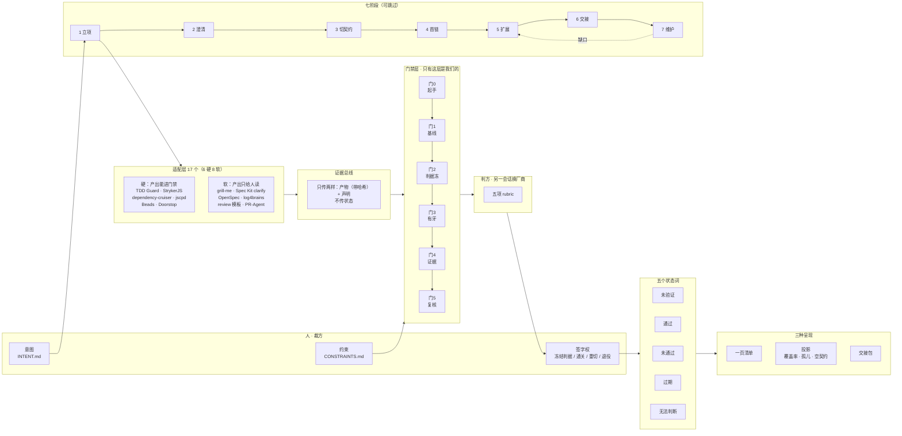

# 节点契约 · 设计入口

**版本**：2026-11-18。经五轮评审：第一轮审计 8 条规格问题、第二轮复审 6 条（其中 1 条撤回规则）、第四五轮综合处置，另有业界做法对照自查 3 条。**改了什么见 [../README.md](../README.md) 的「这一版改了什么」。**

**这一版的核心变化都动了机制，不是措辞**：门 3 换成变异测试的八态词汇、过期传播改成**待重验**（early cutoff 试过后撤回，见 [adr/005](adr/005-删掉代码按业务流程组织这条前提.md) 之后的 02 第十一节）、退出码从三值改四值、执行隔离从「声称安全边界」改成「声明 + 探针验收」、门 5 五项改成三值 + 方向、总账改成六栏加通过四分。

**结论放最前面，因为它是这套设计唯一有证据支持的话。**

> **它压得住「代码与判据」这一层的自欺。** 拿 22 条真实缺陷逐条回放：代码与判据类 7 条全挡住，文档类 9 条只挡住 4 条，架构与概念类（C-01~C-03、D-01~D-03）6 条一条也没挡住，合计 **11/22 = 50%**。
>
> **它不能保证「单人 vibe coding 成功率非常高」。** 三层验证跑了三条：V1 的指标被自己的数据证伪、之后误拦率实测 43%（改一条定义后降到 0%），V4 判方一致率 70% 未达标，而样本里几乎没有干净项、**这次试验的结论不成立**，**这两条未通过**；V3 交接实测初测 **0/3**，改造交接包两次之后 **3/3 通过**——但那是为这次改写过的交接包，改代码之后必须重新生成。结果层需要 30 个项目跨 6 个月，单机条件永久不可测。
>
> **所以它的真实适用范围是**：一个人的长周期项目，在**代码、判据、门禁**这一层最容易被自欺的那一半。另一半——**文档与交接**——它只有有限作用，而长周期项目主要烂在那一半。

## 它想做什么

让「这一轮做完没有」由一份冻结的判据加一次真实运行回答，不由人回忆，也不由 AI 自述。

**这句话本身没错，但它只是设计的意图，不是已经达到的结果。** 上面那三段才是已经测出来的。

## 一张图看完



**读法**：人写下意图与约束，七个阶段由适配器干活，适配器只往总线上放产物与声明；总线的东西全部过六道门才变成状态；判方在门 5 复核，人签字才算通关；状态只用来出三种呈现。

## 五个词

| 词 | 一句话 |
|---|---|
| **契约** | 一个可独立验收的工作单元，有自己的代码范围与若干条判据 |
| **判据** | 一条命令加一个期望，或一条明确的人工判断标准。必须冻结，必须人签 |
| **证据** | 三件套加材料指纹。代码一改，指纹不符，判过期 |
| **有牙** | 这条判据被故意改坏的实现真的弄红过 |
| **状态** | 未验证 / 通过 / 未通过 / 过期 / 无法判断。没有第六个 |

## 三条底线

1. 机器只判「说的和做的是不是一致」。这个功能该不该做，由人判。
2. 判据必须先于实现存在，并且冻结。先写实现再补判据，等于让被判的人自己出题。
3. 任何状态都必须能从当前材料重算。算不出来的显示「无法判断」，不许估、不许猜。

## 按你的身份选入口

| 你是谁 | 读什么 | 大概多久 |
|---|---|---|
| 想知道这是什么东西 | 这份 README，加 [01-图.md](01-图.md) | 10 分钟 |
| 要评审这个设计 | [04-RFC.md](04-RFC.md) 的「动机」「缺点」「备选方案」「未决问题」四节 | 20 分钟 |
| 要动手实现 | [02-规格.md](02-规格.md) 全文，再加 [03-走查.md](03-走查.md) | 1 小时 |
| 要知道某个决定为什么这么定 | [adr/](adr/) 目录，按编号查 | 按需 |
| 要验证这套设计 | [06-验证方案.md](06-验证方案.md) | 20 分钟 |
| **只想判断这东西值不值得用** | [07-结论.md](07-结论.md) | **5 分钟** |
| 要知道 67 条已知失效怎么防 | [../参考/22-67问题防御矩阵.md](../参考/22-67问题防御矩阵.md) | 按需 |
| 要知道选了哪些开源项目、覆盖到哪 | [../23-工具覆盖审计与补选.md](../参考/23-工具覆盖审计与补选.md) | 按需 |

## 档案清单

| 文件 | 给谁 | 有多少 |
|---|---|---|
| `README.md` | 所有人 | 这一页 |
| [01-图.md](01-图.md) | 评审者、实现者 | 图集，每张配一句读法 |
| [02-规格.md](02-规格.md) | 实现者 | **全档案最重的一份（约 100 KB、十六节）**。不变量、对象字段（含**功能**）、计数、执行、总线、有牙、rubric、命令、阶段、阈值、过期、覆盖率、健康自检、许可、各道门的条件、**功能视图**。**按节查，不要一次读完** |
| [03-走查.md](03-走查.md) | 实现者 | 一个真实项目从 T0 到 T1 的逐小时走查，加存量项目迁移路径 |
| [04-RFC.md](04-RFC.md) | 评审者、未来的自己 | 动机、缺点、备选、未决 |
| [06-验证方案.md](06-验证方案.md) | 要验证的人 | 命题拆三层、五条验证（数据 / 做法 / 指标 / 判据 / 成本）、推翻条件、测不了的那一层 |
| [07-结论.md](07-结论.md) | **第一次接触的人** | 一页说完：能做什么、不能做什么、实测过什么、适用边界、最小起步、测不了的 |
| [08-失效链.md](08-失效链.md) | **评审者、排期的人** | 七条串联失效链，以及「17 个部分为什么只到部分」 |
| [09-形态选型.md](09-形态选型.md) | **评审者、业主** | 七个部署形态备选与取舍——**未决**，等评审与实验结果 |

| [adr/](adr/) | 未来的自己 | 决策记录，一条一个文件，不可改写 |
| [../22-67问题防御矩阵.jsonl](../参考/22-67问题防御矩阵.jsonl) | 机器 | 67 条问题逐条处置的台账，一行一条 |

**编号缺 05**：`05-自我拷问.md` 已按「只留规范与决策、不留过程叙事」的原则删除（它的结论已并入 [02-规格.md](02-规格.md) 与各条 ADR）。**编号不重排**，因为全包有多处按编号引用，重排会让它们全部失效。

## 怎么自己核

在本包根目录跑：

```text
node "tools/check-package.mjs"
```

它查的是**结构与链接**：主文件齐、相对链接可达、代码块只有 mermaid 与 text、必备章节齐、ADR 五段齐、不变量与命令计数、67 条覆盖。

**它全绿只证明「档案自洽且链接完整」，不证明设计有效。** 这条写在 [adr/007](adr/007-自评结论必须降一档并披露.md) 里。

**本包不含任何「当前进度」**——没有成绩单、没有过程叙事、没有轮次记录，也不含任何「现在做到第几步」的断言。要核 67 条各自由哪道门挡、依据多硬，直接读 [../22-67问题防御矩阵.jsonl](../参考/22-67问题防御矩阵.jsonl)，一行一条。
## 两条关于形式的决定

**主文件数不设上限，但每份必须有唯一读者与唯一待答问题，且必须出现在上面的路由表里。** 这是 [adr/009](adr/009-撤销主文件数上限.md) 取代 [adr/006](adr/006-档案封顶五份主文件.md) 的一条规则：数量是错的约束，重复才是要防的。

**图用 Mermaid 写在 Markdown 里，不用图片，也不用外部 HTML。** 理由三条：GitHub 原生渲染，读者不用装东西；文本可 diff，改图能看出改了哪一行；图不会被导出成一张没人能改的 PNG。这条决策记在 [adr/001](adr/001-图用-mermaid-写在-markdown-里.md)。

**决策一条一个文件，不写进正文。** 正文只写「现在是什么」，理由与取舍进 ADR。这样正文可以随实现改，ADR 不用改——ADR 改了就没有意义了。

## 与仓库旧文档的关系

这套设计替代 `21-产品设计-1117版.md`。旧文件已删除，内容全部并入本目录，其中：

- 对象、门禁、阶段、界面 → [02-规格.md](02-规格.md)
- 结构性的「为什么这么定」→ [04-RFC.md](04-RFC.md)
- 十五个未决缺口与四个结构性风险 → [04-RFC.md](04-RFC.md) 的「未决问题」一节

`22`、`23` 两份保持不变，它们是查表用的账本，不是叙事。
